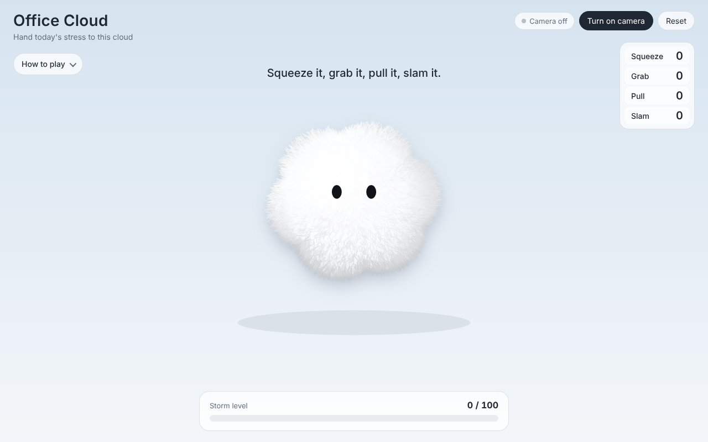
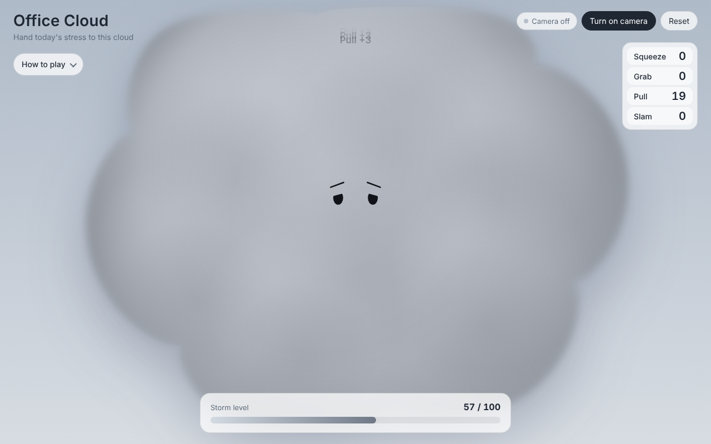
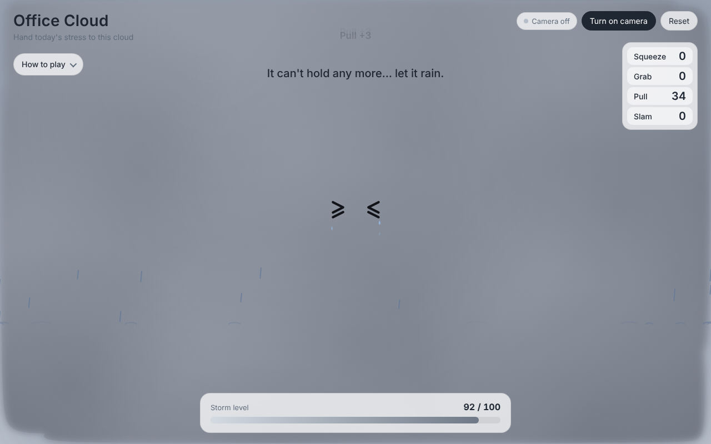

# Office Cloud ☁️

**Hand today's stress to a cloud.**

Office Cloud is a playful, camera-based stress-release prototype for young office workers. It's part of an MFA Interaction Design thesis on work stress and **psychological detachment after work** among early-career employees (1–3 years of experience) in China.

You use your bare hands in front of a webcam to squeeze, grab, pull and slam a soft, fluffy cloud. Each action feeds it a little of your stress. The cloud turns grayer, grows, and gets sadder until it fills the screen. Then it rains, and the cloud goes back to its small, calm self.

| Calm | Getting stormy | Let it rain |
|---|---|---|
|  |  |  |

---

## Try it

**Live demo:** `https://<your-username>.github.io/office-cloud/`
(Replace this with your link after you turn on GitHub Pages; see below.)

1. Open the page in **Chrome** on a laptop with a webcam.
2. Click **Turn on camera** and allow camera access.
3. Stand back a little so both hands are visible. Keep your hands at **chest height**, not up by your face.

No camera? You can play the whole thing with a mouse or keyboard.

---

## How to play

| Action | Hands | Mouse | Key |
|---|---|---|---|
| **Squeeze** | Open palm on the cloud, then clench it into a fist. Repeat it like a stress ball. | Click | `1` |
| **Grab** | Keep the fist closed (~0.8 s) or move it, and the cloud follows your hand. | Press and hold | `2` |
| **Pull** | Make fists with **both hands** on the cloud and pull them apart. The stretch follows the real distance between your fists. | Drag from the edge | `3` |
| **Slam** | Grab the cloud, lift it, then swing it down. It hits the floor. | Drag from the middle and fling | `4` |

`R` resets the cloud.

**Storm level (bottom bar)**

- **0–49:** plain bean eyes.
- **50–89:** sad eyes, and the cloud keeps growing.
- **90+:** `> <` eyes, and the cloud fills the screen.
- **100:** it rains for ~10 seconds, then shrinks back to its original size.

Harder, faster actions add more points.

---

## Design intent

Research on recovery from work stress (e.g., Sonnentag's *psychological detachment*) suggests that people recover better when they mentally switch off from work during non-work time. Office Cloud explores whether a short, **physical, and slightly silly** ritual can help with that switch-off, before or after leaving the office:

- **Externalize:** stress becomes something visible outside your body, a cloud you can see filling up.
- **Embodied release:** whole-hand, whole-arm gestures (squeeze, pull, slam) instead of tapping a screen.
- **Closure:** the rain is a clear ending. The cloud empties and resets, a cue that the workday is done.
- **Low stakes and cute:** no score to win and no failure state. It's a soft companion, not a productivity tool.

---

## How it works

Everything runs in one HTML file in the browser. No server, no build step, and nothing is recorded or uploaded.

- **Hand tracking:** [MediaPipe Hand Landmarker](https://developers.google.com/mediapipe/solutions/vision/hand_landmarker) (`@mediapipe/tasks-vision` 0.10.14), tracking up to 2 hands in real time.
- **Fist detection:** the average 3D distance from the fingertips to the palm center, divided by palm length, with hysteresis so the state doesn't flicker.
- **Gesture logic:**
  - Open → fist = **Squeeze**.
  - A held or moved fist = **Grab**.
  - Two fists = **Pull**.
  - Peak downward hand speed while holding, or hitting the floor = **Slam**.
- **Rendering:** Canvas 2D: a polar cloud shape, about 13,000 shaded fur strands, and spring physics with gravity, a floor and walls.

> 🔒 **Privacy:** the camera feed is processed locally in your browser. No video or images leave your computer.

---

## Run locally

Download or clone the repo and open `index.html` in Chrome.

If the camera doesn't start from a local file, serve the folder instead:

```bash
python3 -m http.server 8000
# then open http://localhost:8000
```

An internet connection is needed the first time, to load the MediaPipe library and hand model from a CDN.

---

## Tuning

All the knobs are in the `CONFIG` block near the top of `index.html`:

| Problem | Try |
|---|---|
| Score rises too fast or too slow | `RATE` (e.g. `0.5` → `0.3`) |
| Fists aren't detected | Raise `FIST_ON` (e.g. `0.85` → `0.9`) |
| Open palm isn't detected, so Squeeze doesn't fire | Lower `OPEN_AT` (e.g. `1.15` → `1.05`) |
| You have to raise your hands too high | Raise `HAND_Y` (e.g. `0.62` → `0.7`) |
| Pull is too hard to trigger | Lower `PULL_TRIGGER` (e.g. `1.22` → `1.15`) |
| Slam is too hard to trigger | Lower `SWING` (e.g. `3.5` → `2.8`) |

---

## Project structure

```
office-cloud/
├── index.html        # the whole prototype (HTML + CSS + JS)
├── screenshots/      # images used in this README
├── README.md
└── LICENSE
```

---

## Credits

Designed by **Shuyang**, MFA Interaction Design, School of Visual Arts (SVA), 2026.
Hand tracking by Google MediaPipe. Prototype code developed with AI assistance (Claude).

## License

[MIT](LICENSE)
